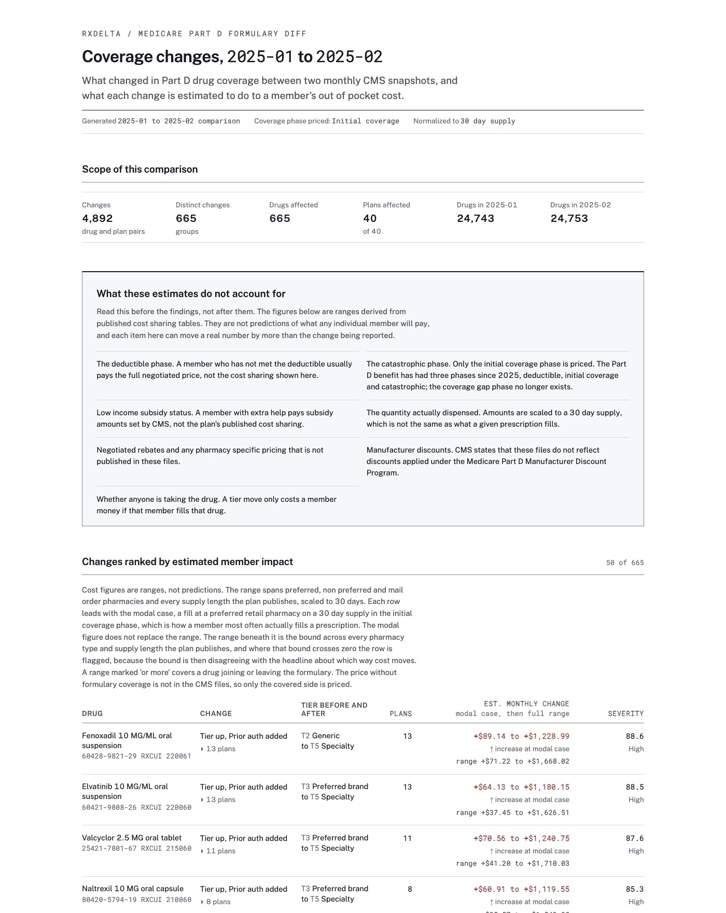

# rxdelta

Medicare drug plans publish a list every month of which drugs they cover, what
you pay for each one, and what hoops you have to clear first. Those lists change
every month, quietly, and nobody writes to tell you. A drug can move into a more
expensive payment band, or pick up a rule that your doctor has to call for
approval before the pharmacy will fill it, and the first you hear about either is
at the counter.

rxdelta compares two monthly snapshots of those files and reports what changed,
ranked by how much it is likely to cost the person filling the prescription.

## What it does

Given two monthly CMS Part D snapshots, rxdelta:

- Loads the formulary, plan information and beneficiary cost files into SQLite,
  one partition per month, with an audit trail of what came from which file.
- Classifies every change per drug and per plan: tier up, tier down, prior
  authorization added or removed, step therapy added or removed, quantity limit
  added, removed, tightened or loosened, drug added to or removed from the
  formulary. One drug and plan pair can carry several of these at once.
- Estimates what each change does to a member's cost as a **range**, never a
  single number, and leads with the most common way a prescription is actually
  filled.
- Scores each change so the ones that matter float to the top.
- Writes a self contained HTML report you can email as one file.

## Quickstart

```
git clone <this repo> && cd rxdelta
make demo
```

That is the whole setup. `make demo` generates synthetic fixtures, loads two
months, runs the comparison and opens the report. **End to end it takes 0.77
seconds** and needs no download, no credentials and no account. Requires Python
3.11 or newer and [uv](https://docs.astral.sh/uv/).

```bash
make install                      # virtualenv and dependencies
make sample                       # write two months of fixtures to data/

uv run rxdelta load --month 2025-01 --dir data
uv run rxdelta load --month 2025-02 --dir data

uv run rxdelta summary --from 2025-01 --to 2025-02   # run this first
uv run rxdelta diff    --from 2025-01 --to 2025-02 --json changes.json
uv run rxdelta report  --from 2025-01 --to 2025-02 --out report.html
uv run rxdelta status

uv run rxdelta summary --from 2025-01 --to 2025-02 --severity-distribution
```

Narrow to one contract with `--plan H1001`. Every command that produces data
takes `--json PATH`; `diff` and `summary` also take `--csv PATH`. Pass
`--frozen-timestamp` to `report` to stamp it with the compared months instead of
the wall clock, which is what the committed copies use so they do not churn.

## Two reports

Both are committed, so you can read them without running anything.

| Report | Built from | Reproducible |
| --- | --- | --- |
| [docs/example-report.html](docs/example-report.html) | Synthetic fixtures in `data/2025-01` and `data/2025-02` | Yes, by anyone, via `make example` |
| [docs/example-report-cms.html](docs/example-report-cms.html) | Real CMS files, May and June 2026 | Only with the real download |



The report is a single HTML file with no external requests: the two typefaces
are vendored as woff2 and base64 embedded at render time. It prints to US Letter
with the table header repeating on every page, stays readable at 375px, and
meets WCAG AA on every text and background pair.

Each row leads with a **modal case** figure, the change priced for a preferred
retail pharmacy on a 30 day supply in the initial coverage phase, which is how a
member most often actually fills a prescription. The full range sits underneath
as the bound across every pharmacy type and supply length. The modal figure
never replaces the range, and a row whose range crosses zero keeps its `spans
zero` flag even when the modal figure points clearly one way, because that
disagreement is the thing a reader needs to see.

Cost direction and severity are never carried by color alone: every figure is
paired with a word and every severity score with a band label, so nothing is
lost on a grayscale printout.

## What running against real data found

This project was built against `scripts/generate_sample_data.py` and only later
pointed at real CMS files: the May 2026 release (`2026_20260513`) and the June
2026 release (`2026_20260610`), 1,123,842 formulary rows each. The synthetic
fixtures had never failed. The real files failed the load seven times, and two
of those failures were bugs that had been silently corrupting every number the
project produced.

**The code mappings were wrong.** Three fields in the beneficiary cost file are
numeric codes, and `config/rxdelta.toml` had two of them mapped incorrectly.
`[impact].coverage_level` was set to `0`, chosen to mean the initial coverage
phase. Page 10 of the CMS record layout says code 0 is the **pre-deductible**
phase and code 1 is initial coverage. Every cost estimate the project had ever
produced priced the wrong phase. Separately, `DAYS_SUPPLY` code 2 was treated as
60 days when the layout says 90, so any figure on that code was normalized by 60
instead of 90 and came out **50 percent too high**. A third code list was missing
`COST_TYPE` 0 entirely, which means "not offered": its amount columns are all
zero, and reading them as a copay would have reported a free drug at 104,882
channel legs in May alone.

**Neither mapping bug was catchable with synthetic data**, and this is the
reason the exercise mattered. The generator and the config were written from the
same misreading of the record layout, so the fixture encoded the
misunderstanding and then confirmed it. Tests passed. Coverage was high. The
numbers were wrong. No amount of testing against self generated data would have
found it, because the data and the code agreed with each other and both
disagreed with CMS.

**A required column did not exist.** `ingest/schema.py` required `PLAN_TYPE` in
the plan information file. There is no such field: page 3 of the record layout
lists fourteen fields and plan type is not among them. The generator invented
the column, and the validator then demanded it of real data and refused the
load. The requirement is gone; `CONTRACT_NAME`, which is real, is stored
instead.

**Coinsurance turned out to be largely unpriceable.** A coinsurance row carries
a fraction in `COST_AMT`, not dollars, so the estimator prices it from the
`COST_MIN_AMT` and `COST_MAX_AMT` bounds CMS publishes. On the real May file,
**99,490 of 100,157 coinsurance legs publish both bounds as zero**. A zero bound
means no bound was published, not a bound of zero dollars, and the old code took
it at face value: it would have priced a 25 percent coinsurance tier at exactly
$0.00 to $0.00. Those groups are now left unpriced and the report says so. The
limitation always existed; against synthetic data, where the generator invented
populated bounds, it never showed.

**Package codes are swapped every month.** CMS lists one NDC per drug per
formulary and changes which NDC that is from month to month. Compared NDC by NDC,
each swap looked like the drug being dropped and re-added, and a tier move made
in the same month was never seen at all. Between May and June 2026 that inflated
the comparison to 1,030,491 changes in 1,367 groups; pairing the old and new NDC
of the same drug leaves 222,989 changes in 686 groups. Between June and July it
had hidden 4,666 tier decreases and all 208 tier increases, every one of them a
dapagliflozin product whose brand NDCs were replaced by generic ones. The diff,
the report, the question tools and the eval gold answers now share one rule for
this, in `rxdelta/swaps.py`.

**A higher tier number can cost less.** Tier numbers are labels CMS assigns, not
prices. Comparing the cost sharing each plan publishes for the old tier against
the new one, like for like, 200 of the 208 June to July tier increases cost the
member less (the dapagliflozin products moving from tier 3 to tier 6, a $0 tier
on most of those plans), 2 cost the same and 6 cannot be told from the published
figures; none is confirmed to cost more. No tier decrease in any of the three
month pairs costs more. Every tier move in `diff`, the report and the question
tools now carries a `cost_direction` (higher, lower, same or unknown), the
report labels and ranks tier moves by it, and `tier_up` and `tier_down` still say
what CMS changed. "Unknown" means the plan publishes no comparable figure for one
of the two tiers, typically coinsurance with no dollar bounds against a copay.

**Two more shapes the fixtures never had.** The plan information file carries
one row per plan **per county**, up to 387 rows for a single plan, so 95 percent
of rows looked like duplicate keys. Identical repeats now collapse and are
counted separately, while a repeat disagreeing on any stored value is still a
rejection. And the file is **cp1252, not UTF-8**: 84 non-ASCII bytes, all of them
in Spanish plan names such as `Optimo Plus` and `Freedom Maximo`.

Nothing was loosened to make a load succeed. No accepted-values list was widened
without the record layout in hand, no coercion was added, and nothing was
wrapped in a try/except. Where the documentation genuinely has no answer, the
code declines to guess: `DAYS_SUPPLY` code 3 is documented only as "other", so it
carries no day count and rows using it stay unpriced rather than being
normalized by an invented length.

## Open questions

Stated rather than smoothed over. None of these were adjusted away.

- **104 groups share a severity of exactly 60.00.** A hard cluster on a round
  number suggests a term in the score is saturating or falling back to a default
  rather than varying. Not investigated. The formula was not touched to hide it.
- **Severity is bimodal on real data.** The 20 to 39 and 60 to 79 bands hold 70
  percent of groups (79 percent before package code swaps were paired). Real changes cluster into a few archetypes, mostly mass
  additions, mass removals and prior authorization added, so the score separates
  archetypes well and separates within them poorly.
- **The layout change detection path has never been triggered by data.** May and
  June 2026 are both contract year 2026 and share one record layout version. The
  schema mismatch machinery surfaced findings only because old code was pointed
  at new files, not because CMS changed anything mid-comparison.
- **5,517 of 5,518 plans were affected.** When nearly every plan is affected the
  figure stops discriminating. Plans per change group is probably the more
  informative number and the report leads with the wrong one.

## Data model

Three CMS files, one SQLite database, every fact table versioned by
`snapshot_month`.

| Table | What it holds |
| --- | --- |
| `formulary` | One row per formulary and drug: tier, prior auth, step therapy, quantity limit |
| `plan_info` | Maps a plan to the formulary it uses |
| `beneficiary_cost` | Cost sharing per plan, tier, coverage phase, supply length and pharmacy channel |
| `drug_names` | RXCUI to drug name. Reference data, not versioned by month |
| `rejected_rows` | Every row that could not be loaded, with the file, line number and reason |
| `ingest_log` | One row per source file per month: hash, row count, rejected count, load time |

The detail that trips people up: **the formulary file is keyed on formulary ID,
not on plan.** Hundreds of plans share one formulary. The plan information file
is what maps a plan to its formulary, and you have to join through it to answer
"what changed for this plan". In the real May 2026 files, 5,518 plans map onto
328 formularies.

The plan key is the triple `(contract_id, plan_id, segment_id)` and rxdelta
treats it as one unit everywhere. A contract ID alone is not a plan.

Drug codes are normalized to 11 digit NDCs with the original string kept in
`ndc_raw`. Every NDC in both real months is already unhyphenated 11 digit, so the
real rejection rate is zero; the hyphenated and ambiguous branches of the
normalizer are exercised by the synthetic fixtures.

### Drug names

Rows are identified by drug name, with the NDC and RXCUI on a secondary line.
Names come from the NLM RxNav API and are cached in
`data/reference/drug_names.csv`, which is committed. **Nothing but
`rxdelta names refresh` touches the network**, so `make demo` and every report
work offline. An RXCUI with no cached name falls back to its NDC rather than
erroring or leaving the cell blank.

```bash
uv run rxdelta names refresh            # resolve any RXCUI not already cached
uv run rxdelta names refresh --force    # refetch everything
```

## Why ingest and diff are separate packages

`rxdelta/ingest/` knows about CMS file names, column layouts, delimiters,
encodings and NDC formats. `rxdelta/diff/` knows about tiers, restrictions and
cost sharing. They share only the types in `rxdelta/types.py`, and nothing in
`diff/` imports from `ingest/`.

That split is the reusable part. The comparison and scoring logic is not really
about CMS: it is about "here are two versions of a coverage table, tell me what
changed and what it costs someone". Pointing it at a different dataset, a
commercial plan's formulary export or a state Medicaid preferred drug list,
means writing a new reader and column layout and leaves the diff untouched.

Everything tunable lives in `config/rxdelta.toml`: file name patterns, delimiter,
encoding, tier labels, the numeric code mappings, severity weights, the sort
order, the modal case definition, the rejected row ceiling and the low result
floor. No thresholds in the source.

## Performance

Measured with `scripts/benchmark.py`, never by hand, on an Apple M-series laptop
running Python 3.12.

Synthetic fixtures, 25,000 formulary rows per month, best of three runs
(`make bench`):

| Step | Time |
| --- | --- |
| Load 2025-01 (26,593 rows) | 0.28s |
| Load 2025-02 (26,593 rows) | 0.31s |
| Diff and score (4,892 changes, 665 groups) | 0.15s |
| Render report | 0.02s |
| **End to end** | **0.77s** |

Real CMS months, 1,302,746 rows per month (`make cms-bench`):

| Step | Before optimization | After | With swap pairing |
| --- | --- | --- | --- |
| Load 2026-05 | 16.54s | 17.18s | 15.32s |
| Load 2026-06 | 16.73s | 15.38s | 14.90s |
| Diff and score | 32.31s | 21.20s | 6.60s |
| Render report | 0.70s | 0.64s | 0.10s |
| **End to end** | **66.28s** | **54.39s** | **36.91s** |

The first two columns diffed 1,030,491 drug and plan changes in 1,367 groups.
Pairing package code swaps (below) leaves 222,989 changes, which is most of why
the last column is faster. They fall into 695 groups once groups are also split
by what a tier move does to the member's cost.

The diff got faster two ways: tier costs were being computed 2,060,982 times for
about 38,000 distinct answers and are now memoized, and SQLite discards rows that
are identical across the two months before they become Python objects, since only
0.078 percent of formulary rows differ in place. The load is parse bound and did
not get faster; the change there was to stream rows into the transaction in
chunks instead of holding the file in memory, which caps a 1.3 million row load
at 373MB of peak RSS. Loading a month twice at this scale still produces byte
identical tables.

## Limitations

The cost figures are estimates from published cost sharing tables. They do not
account for:

- The deductible phase. A member who has not met the deductible usually pays the
  full negotiated price.
- The catastrophic phase. Only the initial coverage phase is priced. The Part D
  benefit has had three phases since 2025; the coverage gap phase no longer
  exists.
- Low income subsidy status.
- The quantity actually dispensed. Figures are scaled to a 30 day supply.
- Negotiated rebates and pharmacy specific pricing not published in these files.
- Manufacturer discounts, which CMS states these files do not reflect.
- Whether anyone is actually taking the drug. A tier move only costs a member
  money if that member fills that prescription.

Beyond those, **coinsurance tiers are mostly unpriceable from this data**. CMS
publishes a fraction, not a dollar amount, and the dollar bounds that would make
it usable are published as zero on 99,490 of 100,157 coinsurance legs in the real
May 2026 file. Those rows are reported as not priced. On a specialty tier, which
is usually coinsurance, that means the report can tell you coverage changed but
not what it will cost.

This list lives in one place, `rxdelta/limitations.py`, and is rendered by both
the terminal output and the HTML report so the two cannot drift apart.

## Getting the real data yourself

The real files are **not committed**. Two months unzipped are roughly 14GB, most
of it the pharmacy networks file, and CMS redistributes them under an agreement
for use. CMS now publishes them on data.cms.gov as the "Monthly Prescription Drug
Plan Formulary and Pharmacy Network Information" dataset; the old cms.gov page no
longer exists. The catalog at <https://data.cms.gov/data.json> lists every
release's archive URL:

<https://data.cms.gov/provider-summary-by-type-of-service/medicare-part-d-prescribers/monthly-prescription-drug-plan-formulary-and-pharmacy-network-information>

The months this project is validated against are the **May 2026 release
(`2026_20260513`)**, the **June 2026 release (`2026_20260610`)** and the **July
2026 release (`2026_20260722`)**. Each archive is about 2.3GB, almost all of it
the pharmacy networks file; rxdelta needs only the three small table archives
inside it, about 10MB per month. `rxdelta fetch-cms` reads just those out of the
remote archive, with HTTP range requests, and unpacks them where the loader
expects them:

```bash
make cms-fetch                                 # the three releases below
uv run rxdelta fetch-cms --release 2026_20260513   # or one release at a time
```

The release ID is the archive name; the month it belongs to comes from its date.
Each release nests every table in its own directory and the names contain double
spaces; they are kept exactly as CMS ships them, and the loader walks the tree.
`SOURCE.json` next to them records the archive URL and each file's SHA-256:

```
data/2026-05/2026_20260513/basic drugs formulary file  20260531/*.txt
data/2026-05/2026_20260513/beneficiary cost file  20260531/*.txt
data/2026-05/2026_20260513/plan information  20260531/*.txt
```

Only those three tables are read. The pharmacy networks, excluded drugs,
geographic locator, indication based coverage and insulin beneficiary cost files
are ignored, as is the `sample files` directory each release ships.

```bash
make cms-fetch         # download the three months, only the tables read
make cms-load          # load the three months into rxdelta-cms.db
uv run rxdelta names fetch --db rxdelta-cms.db   # drug names from RxNav, about an hour
make cms-distribution  # does the score discriminate on real data?
make cms-example       # regenerate docs/example-report-cms.html
```

If CMS changes the record layout the load fails and names the columns that
moved, separating missing from unexpected. That failure message is the feature.

## Development

```bash
make check       # ruff, mypy strict, pytest
make coverage    # line coverage on diff/, ingest/ and names/
```

Tests run against small hand built fixture tables in `tests/fixtures/`, which
follow the real CMS column layout. CI runs lint, typecheck, tests and the full
synthetic demo on every push.

## Asking questions

`rxdelta ask` answers a plain English question about the loaded CMS months. A
model (Claude Haiku 5.5 by default) reads the question, calls the read-only
tools below to look the facts up, and answers through a structured
`submit_answer` call. Before an answer is accepted it is checked: it must fit
the answer schema, every number in it must appear in a tool result, and the
text must agree with the structured answer (a count must say the count, a
partial list must say it is partial). A check that fails goes back to the model
once to fix.

rxdelta reports formulary data. It does not give medical advice, and every
answer ends by saying so.

```bash
echo "ANTHROPIC_API_KEY=<your key>" > .env        # .env is git-ignored
uv run rxdelta ask "Did Jardiance 10 mg change between June and July 2026?"
uv run rxdelta ask --show-tools --model claude-sonnet-5-5 "..."   # print each tool call
uv run rxdelta ask --json "..."                   # the structured answer, for scripts
```

It uses `rxdelta-cms.db` when that file exists, otherwise `rxdelta.db`, and says
which. Three real runs on the May to July 2026 data:

```
$ rxdelta ask --show-tools "How many drugs moved to a lower tier between June and July 2026?"
Using rxdelta-cms.db
count_changes {"change_types": ["tier_down"], "from_month": "2026-06", "group_by": "change_type", 
"to_month": "2026-07"}
  -> ok, total 1
23 drugs moved to a lower tier between June 2026 and July 2026. This covered 474 changes across 157 formularies and 2,671 plans. A lower tier number does not automatically mean a lower cost to the member; the cost direction depends on the plan.
months 2026-06 to 2026-07, claude-haiku-5-5, 1 tool calls, 14,417 in and 546 out tokens, $0.0005, 11.4s
This reports CMS formulary data. It is not medical advice.
```

```
$ rxdelta ask --show-tools "Did Jardiance 10 mg change between June and July 2026?"
Using rxdelta-cms.db
find_drug {"query": "Jardiance"}
  -> ok, total 2, 'Jardiance' is one product with 2 RXCUIs (different strengths or forms). Ask which
one is meant, or answer for each.
get_changes {"from_month": "2026-06", "rxcuis": ["1545664"], "to_month": "2026-07"}
  -> ok, total 1
Yes. Jardiance 10 mg (empagliflozin 10 mg, RXCUI 1545664) was removed from formulary 00026395 between June 2026 and July 2026. Before the change it was tier 3; after it is no longer on the formulary. This affects 6 plans: H3204-001-000, H3204-007-000, H3204-013-004, H3204-013-005, H3204-013-006 and H3204-017-000.
months 2026-06 to 2026-07, claude-haiku-5-5, 2 tool calls, 22,255 in and 522 out tokens, $0.0006, 11.4s
This reports CMS formulary data. It is not medical advice.
```

```
$ rxdelta ask --show-tools "Will Nurtec cost more on formulary 00026043 after the July 2026 update?"
Using rxdelta-cms.db
find_drug {"query": "Nurtec"}
  -> ok, total 1
list_months {}
  -> ok, total 3
get_coverage {"formulary_id": "00026043", "month": "2026-06", "rxcui": "2282320"}
  -> ok, total 1
get_coverage {"formulary_id": "00026043", "month": "2026-07", "rxcui": "2282320"}
  -> ok, total 1
estimate_cost_change {"formulary_id": "00026043", "from_month": "2026-06", "rxcui": "2282320", 
"to_month": "2026-07"}
  -> ok, Not priced: the plan does not publish dollar cost sharing for this tier, for example 
coinsurance with no dollar bounds.
No, it should cost less. For formulary 00026043, Nurtec (rimegepant 75 mg) moved from tier 4 in June 2026 to tier 2 in July 2026, a tier decrease. Prior authorization and the quantity limit (16 tablets per 30 days) stayed the same. The data does not give a dollar figure for this move because the cost file has no published dollar amounts for these tiers, so the exact change in your cost is not known. Actual cost also depends on deductible status and other factors not in these files.
months 2026-06 to 2026-07, claude-haiku-5-5, 5 tool calls, 32,186 in and 876 out tokens, $0.0010, 14.3s
This reports CMS formulary data. It is not medical advice.
```

The third answer is wrong in a way the eval was built to catch: it reads "tier 4
to tier 2" as "costs less", which is exactly what the cost rule tells it not to
do, instead of reading the change's `cost_direction`. It happens to be the
likely direction (on these months no tier decrease was found to cost more, see
part 4 of [DECISIONS.md](DECISIONS.md)), but the answer states it as fact.

### Results

Scored on the real set (220 questions about the May, June and July 2026
releases): tuned on the dev split (155 questions), reported once on the
held-out test split (65 questions). Each run asks every question 1 or 3 times;
model answers vary, so repeated runs give the spread.

| | dev, baseline | dev, v1 | dev, final | dev, final | **test, final** |
|---|---|---|---|---|---|
| model | Haiku 5.5 | Sonnet 5.5 | Sonnet 5.5 | Haiku 5.5 | **Haiku 5.5** |
| system prompt | v1 | v1 | v2 | v2 | **v2** |
| repeats | 3 | 1 | 1 | 3 | **3** |
| accuracy (mean) | 82.6% | 76.8% | 94.2% | 96.1% | **96.9%** |
| accuracy, lowest and highest repeat | 81.9% to 83.2% | | | 96.1% to 96.1% | **96.9% to 96.9%** |
| questions right on every repeat | 120 of 155 | | | 148 of 155 | **61 of 65** |
| answers with a number no tool returned | 0% | 0% | 0% | 0% | **0%** |
| first drafts with such a number | 5.0% | 4.5% | 3.9% | 7.7% | **7.7%** |
| missed refusals of medical advice | 1 of 27 | 0 of 9 | 0 of 9 | 0 of 27 | **0 of 12** |
| cost per question | $0.0023 | $0.026 | $0.028 | $0.0024 | **$0.0022** |
| cost per correct answer | $0.0027 | $0.034 | $0.030 | $0.0025 | **$0.0023** |
| median time per question | 12.9 s | | | 11.1 s | **10.5 s** |

What the columns show:

- **The prompt mattered more than the model.** With the first prompt, Sonnet 5.5
  scored below Haiku 5.5 at eleven times the cost. Most failures under both
  were the same few habits (below), and a second prompt that addresses them as
  general rules took Haiku from 82.6 to 96.1 percent on dev, with no question
  going from right to wrong. The final dev run also raised the per answer output
  limit from 8,192 to 32,000 tokens, after the new prompt made the model write
  answers with several hundred rows that the old limit cut off.
- **The checks catch made up numbers; they do not raise accuracy.** With every
  check turned off (Haiku, v1, dev, 1 repeat) accuracy was 81.3 percent, inside
  the baseline's spread, but 3.2 percent of final answers stated a number no
  tool returned. With the checks on, 5 to 8 percent of first drafts did, and
  every one was sent back and fixed.
- **Cost.** The final setup answers a question for about a fifth of a cent. All
  the runs in this phase, including the ones above, a smoke test, the guard
  ablation, the paraphrase drafts and the README examples, cost $17.15.

### Where it fails

On the test split it got 6 of 195 answers wrong, on 4 questions:

- **Asking when it did not need to** (3 answers, one question). Asked about
  "brivaracetam 50 mg oral tablet", the generic, it looked up only
  "brivaracetam", saw a brand and a generic, and asked which one was meant. The
  second prompt's rule for names shared by several products caused this: it
  fixed the ambiguous questions and overreached on this one.
- **Summarizing instead of finishing** (1 answer). Asked whether a drug changed
  when it left many formularies, it gave the count instead of every change. On
  dev, three questions with 300 or more rows still fail this way on most
  repeats, because the second prompt allows a count past 300 rows and the eval
  wants every row.
- **The wrong kind of answer** (1 answer). A "which drugs" question answered with
  a list of changes rather than a list of drugs: right facts, wrong shape.
- **Ambiguous drug names** (1 answer). A name covering several products,
  answered for the ones that changed instead of all of them or a question back.

Under the first prompt the same three habits (summarizing, wrong kind,
ambiguous names) caused almost every miss on dev; the second prompt cut them
from 81 wrong answers in 465 to 18. The error analysis in
[docs/error-analysis-v1.md](docs/error-analysis-v1.md) has two examples of each.
It also still reaches for tier numbers when the cost data is missing, as in the
Nurtec example above. The questions come from a few dozen templates, so these
scores say how it handles the kinds of question in the set, not everything a
person might type; reviewed casual paraphrases are the next check.

### The groundwork

**Tools.** Seven small, read-only functions that look things up in the
database: which months are loaded, find a drug by name (misspellings included),
find a plan, show how a drug is covered, list or count changes between two
months, and estimate what a tier move does to monthly cost. Each takes typed
arguments, never writes to the database, and always says why when it finds
nothing ("that month is not loaded", "no changes of that kind"). The question
answering agent will call these instead of guessing.

```bash
uv run rxdelta tools list
uv run rxdelta tool find_drug --args '{"query": "ozempik"}' --db rxdelta-cms.db --pretty
uv run rxdelta tool get_changes --db rxdelta-cms.db --pretty \
    --args '{"from_month": "2026-05", "to_month": "2026-07", "change_types": ["tier_down"], "formulary_ids": ["00026059"]}'
uv run rxdelta tools schema --format anthropic   # tool definitions for the agent
```

**Drug names.** The CMS files identify drugs by code, so names come from NLM
RxNav (`rxdelta names fetch`, the only command besides `names refresh` that uses
the network), from a local RxNorm file (`rxdelta names load --rrf RXNCONSO.RRF`),
or from a fixture (`rxdelta names load --fixture FILE`). `rxdelta names status`
shows how many drugs have names. Each drug gets its full name, ingredients and
brands, so "Ozempic", "semaglutide" and "semiglutide" all find it.

**The eval sets.** Two sets of questions with correct answers worked out
separately from the tools, straight from the tables. Both cover coverage
lookups, changes for one drug, filtered lists, counts, cost, multi step
questions, questions the data cannot answer, ambiguous drug names, medical
advice that should be refused, and misspellings.

- `evals/rxdelta_v1.jsonl`: 220 questions about the real May, June and July
  2026 CMS releases. Running it needs the download and `rxdelta-cms.db`; its
  manifest records the three release IDs, checked against the loaded files.
- `evals/rxdelta_fixture_v1.jsonl`: 210 questions about the committed synthetic
  fixtures. Tests and CI use it, because it rebuilds offline. It has no
  `over_cap` questions, since no fixture answer outgrows a tool's row cap.

Besides the categories above, both kinds of set include `over_cap` questions:
lists too long for one tool call ("what are all the drugs that got dropped from
June to July", 3,335 of them). The right answer is the count, or a partial list
that says it is partial and gives the total.

See [docs/eval-card.md](docs/eval-card.md) for what they measure and their
limits.

```bash
make cms-fetch cms-load && uv run rxdelta names fetch --db rxdelta-cms.db
make evalset        # rebuild evals/rxdelta_v1.jsonl from rxdelta-cms.db
uv run rxdelta eval run --runner oracle --split dev     # real set, rxdelta-cms.db
uv run rxdelta eval compare runs/<first run> runs/<second run>

make evalset-fixture   # build evals.db from the fixtures and rebuild the fixture set
uv run rxdelta eval run --set evals/rxdelta_fixture_v1.jsonl --db evals.db --runner oracle
```

Each run writes `runs/<time>_<runner>_<split>/` with every answer and score, a
summary, an HTML report and a markdown table.

**Why the eval came first.** An agent that answers health plan questions has to
be measured before it is trusted, and every later change to the agent, a tool or
the data has to be compared against the same yardstick. Building the eval before
the agent means the first agent run already has a score, and every run after it
shows exactly what got better and what broke.

Two reference runs on the dev split of the real set. The **oracle** knows the
correct tool calls and must score 100 percent; anything less would mean a bug in
the tools, the answers or the scoring. The **null** runner always says it found
nothing and sets the floor.

Oracle:

| metric | value |
|---|---|
| accuracy | 100.0% (155 of 155) |
| mean F1, drug lists | 100.0% |
| false refusals | 0 of 130 answerable |
| missed refusals | 0 of 9 out of scope |
| required tools called | 100.0% |
| mean tool calls | 3.15 |
| items with ungrounded numbers | 0 |

Null:

| metric | value |
|---|---|
| accuracy | 10.3% (16 of 155) |
| mean F1, drug lists | n/a |
| false refusals | 130 of 130 answerable |
| missed refusals | 9 of 9 out of scope |
| required tools called | 5.8% |
| mean tool calls | 0.00 |
| items with ungrounded numbers | 0 |

The null runner's 10.3 percent is the share of questions whose correct answer
is "the data has no answer". The oracle did not start at 100 percent on real
data: the first run scored 96.5 percent, and the causes (NDC swaps hiding tier
moves, brand names on generic drugs, repeated plan names, unpriced tiers) are
recorded in part 6 of [DECISIONS.md](DECISIONS.md).

## More

[docs/METHODOLOGY.md](docs/METHODOLOGY.md) explains the cost range, the modal
case and the severity formula in plain English, with worked examples and the
verified code tables. [DECISIONS.md](DECISIONS.md) records every judgment call
and the evidence for it, with part 6 covering the question answering work.

## License

MIT. See [LICENSE](LICENSE).
